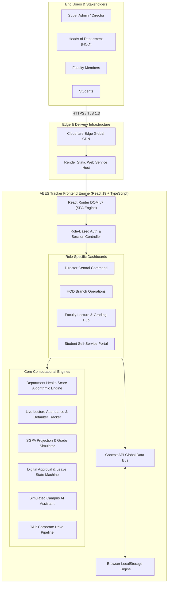
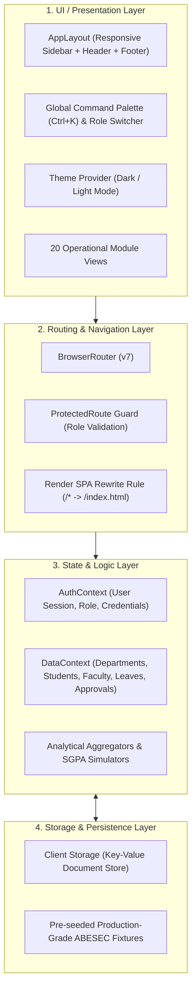
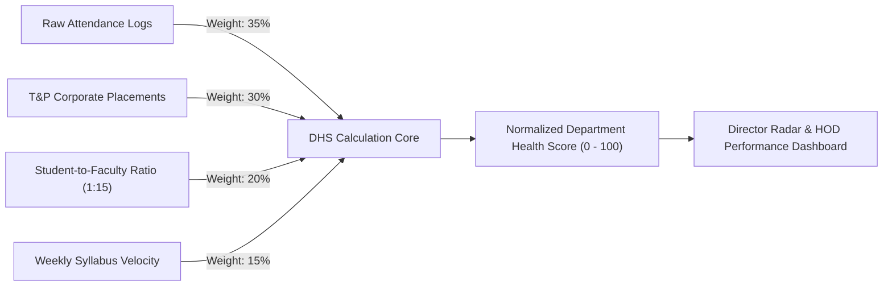
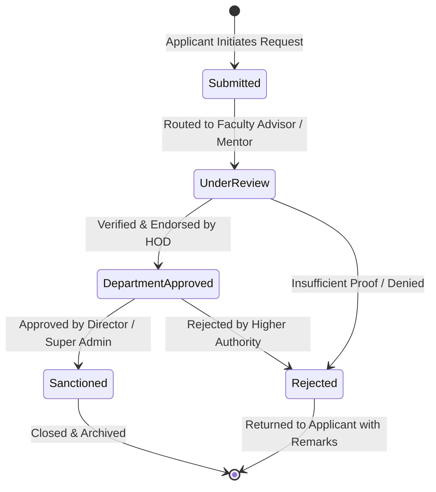
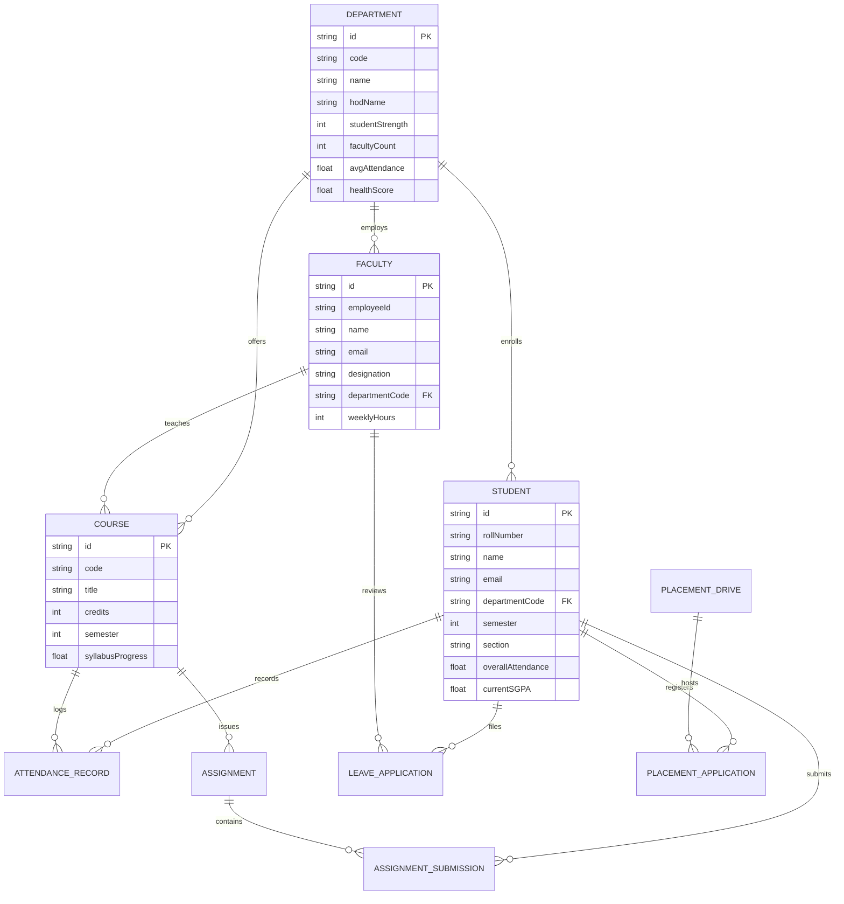
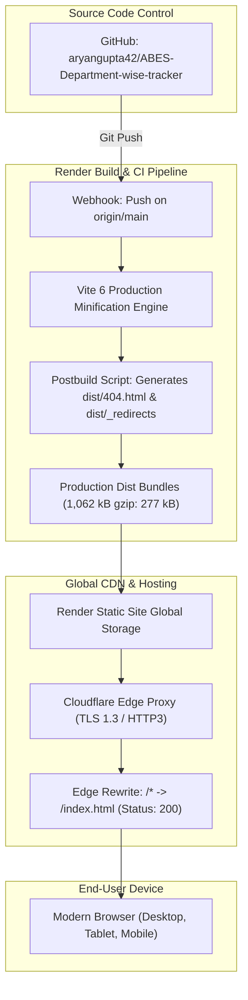
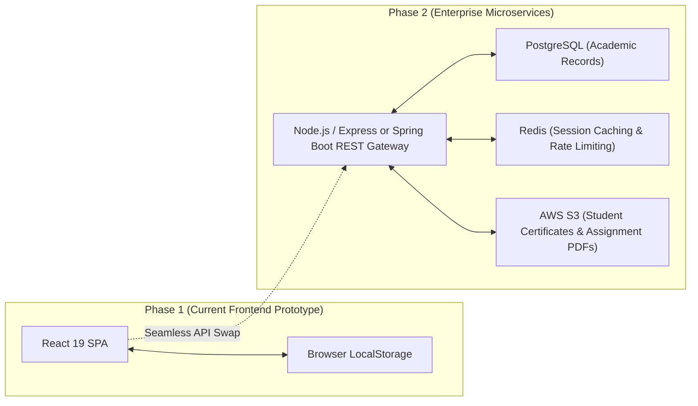

# 🏛️ SYSTEM DESIGN DOCUMENT (SDD)
## ABES Department Tracker — Centralized Academic & Department Monitoring Platform

**Institution:** ABES Engineering College (ABESEC), Ghaziabad  
**AKTU College Code:** 032  
**Academic Year:** 2025–2026  
**Course:** Full Stack Development (FSD) Capstone Project  
**Live Deployed Application:** [https://abes-department-wise-tracker.onrender.com](https://abes-department-wise-tracker.onrender.com)  
**GitHub Repository:** [https://github.com/aryangupta42/ABES-Department-wise-tracker.git](https://github.com/aryangupta42/ABES-Department-wise-tracker.git)  
**Project Team:**
- **Aryan Gupta** (CSE, Section: CSE 15) — Full Stack Development Lead
- **Arsh Mittal** (CSE, Section: CSE 15) — Frontend & Architecture Engineer  

---

## 1. Executive Summary & Problem Formulation

### 1.1 Context & Background
Collegiate institutions such as ABES Engineering College operate at massive scales with multiple accredited engineering branches (CSE, IT, ECE, ME, CE, AI/ML, DS), thousands of students, hundreds of faculty members, and demanding accreditation cycles (NBA Tier-1, NAAC 'A' Grade, NIRF). Traditional college management systems suffer from severe structural drawbacks:
- **Fragmented Data Silos:** Attendance, academic transcripts, training & placement, and grievance ticketing reside in disconnected applications.
- **Outdated User Experience:** Legacy ERPs present clunky, non-responsive tabular designs with high operational friction and zero mobile adaptability.
- **Lack of Real-Time Department Health Visibility:** College leadership and HODs lack algorithmic dashboards to assess department performance, student retention, faculty workload, and compliance margins.

### 1.2 Solution Vision
**ABES Department Tracker** is a next-generation, high-performance SaaS platform engineered to unify academic monitoring, faculty operations, student self-service, and institutional governance into a single cohesive, role-driven web application.

---

## 2. High-Level Architectural Design

### 2.1 Architectural Pattern
The application follows a **Modular Single Page Application (SPA)** architecture paired with a **Unidirectional Data Flow** and a **Centralized Observable State Provider**:
- **Presentation Layer:** Component-driven design powered by React 19 and Tailwind CSS, leveraging atomic component hierarchies (Atoms: Badges, Buttons; Molecules: Stat Cards, Attendance Loggers; Organisms: Dashboards, Modal Dialogs).
- **Application / State Layer:** Unified Context API (`DataContext` & `AuthContext`) acting as the single source of truth for all operational datasets.
- **Persistence Layer:** Structured browser `localStorage` engine with fallback default fixtures mimicking production database tables.
- **Edge Deployment Layer:** Automated CI/CD pipelines deploying immutable static distribution artifacts to Render backed by global Cloudflare Edge caching.

### 2.2 System Architecture Diagram

---

## 3. Role-Based Access Control (RBAC) Specification

The system enforces strict multi-tenant role compartmentalization across four primary personas:

| Module / Capability | Super Admin / Director | Head of Department (HOD) | Faculty Member | Student |
| :--- | :---: | :---: | :---: | :---: |
| **College Overview Dashboard** | Full Access (R/W) | Department Scope | Read Only | Restricted |
| **Department Management** | Full CRUD | Branch Scope | Read Only | View Assigned Branch |
| **Department Health Score** | Global Radar | Branch Score | View | View |
| **Live Attendance Logger** | Audit All | Department Audit | Mark & Submit (P/A) | Self-Attendance View |
| **Defaulter Warning System (<75%)** | College-Wide Audit | Branch Notice Trigger | Auto-Flag Class | Warning Dashboard |
| **Course & Syllabus Progress** | Audit | Approve Completion | Update Weekly Coverage | View Syllabus Tracker |
| **Assignment Lifecycle** | View Metrics | Review Submissions | Create & Grade | Submit Solutions |
| **SGPA / Results Simulator** | College Statistics | Branch Pass % | Grade Entry | Interactive Projection |
| **T&P Placement Drives** | Institutional Stats | Branch Conversions | Mentorship View | Apply & Eligibility Check |
| **Digital Approvals Workflow** | Final Authority | Department Authority | Submit OD/Duty Leave | Submit Medical/Leave |
| **Campus AI Assistant** | Admin Queries | Branch Queries | Academic Queries | Student FAQs |
| **Grievance / Complaints** | Escalated View | Branch Resolution | Forward / Resolve | Lodge & Track Status |

---

## 4. Subsystem & Module Deep Dive

### 4.1 Department Health Score (DHS) Algorithmic Engine
To eliminate subjective department evaluations, the platform introduces a proprietary **Department Health Score Index ($H_D$)**:

$$\text{Health Score } (H_D) = w_1 \cdot A_{\text{avg}} + w_2 \cdot P_{\text{conv}} + w_3 \cdot S_{\text{sfr}} + w_4 \cdot C_{\text{syl}}$$

Where:
- $A_{\text{avg}}$: Aggregate branch attendance percentage ($w_1 = 0.35$).
- $P_{\text{conv}}$: Placement conversion index ($\frac{\text{Placed Students}}{\text{Eligible Students}} \times 100$) ($w_2 = 0.30$).
- $S_{\text{sfr}}$: Student-Faculty Ratio Compliance Index normalized against AICTE statutory standards of 1:15 ($w_3 = 0.20$).
- $C_{\text{syl}}$: Real-time syllabus completion velocity ($w_4 = 0.15$).

### 4.2 Statutory Attendance & Defaulter Alert System
Under AKTU Regulation Ordinance, every student must maintain $\ge 75\%$ aggregate lecture attendance to qualify for End-Semester examinations:
- **Attendance Buffer Metric:** The student portal calculates real-time safe lecture margins:
  $$\text{Margin} = \lfloor \frac{\text{Attended} - (0.75 \times \text{Total})}{0.75} \rfloor$$
- **Defaulter Threshold Flagging:** When attendance dips below $75\%$, the record triggers an orange caution alert; below $65\%$, a red critical alert is broadcast with SMS dispatch simulation to registered guardians.

### 4.3 Digital Workflow & Approval Engine
Replaces paper-based applications for duty leaves, medical concessions, budget sanctions, and lab requisitions with a formal finite state machine:

### 4.4 Simulated AI Campus Assistant
- Contextual intent parser programmed with ABESEC institutional knowledge.
- Capabilities:
  - Attendance threshold computations
  - Placement recruitment drive eligibility checks
  - HOD contact details and cabin coordinates
  - Upcoming college fests (*Genera*, *Technovation*) and hackathon deadlines.

---

## 5. Entity-Relationship & Data Model Specification

---

## 6. UI/UX Design System & Theme Engine

### 6.1 Design Principles
- **Enterprise SaaS Ergonomics:** Clean lines, high content density without visual clutter, inspired by Stripe, Linear, and Notion.
- **ABES Brand Palette:**
  - Navy Corporate Primary: `#0a192f` / `#0f172a`
  - High-Tech Blue Accent: `#1b64e8` / `#2563eb`
  - Success Indicator: `#10b981` (Emerald)
  - Warning / Defaulter: `#f59e0b` (Amber)
  - Critical / Rejection: `#ef4444` (Rose)
- **Typography:** Dual modern typeface pairing using Google Fonts:
  - Primary UI & Prose: `Plus Jakarta Sans` (300 to 800 weights)
  - Monospace Data / Code / Rolls: `JetBrains Mono`

---

## 7. Deployment & Infrastructure Architecture

---

## 8. Non-Functional Specifications & Security

- **Lighthouse Performance Optimization:** Code splitting with dynamic chunk warnings, minified CSS (`58.9 kB`, gzip: `9.3 kB`), and compressed JS bundles (`277 kB` gzip).
- **Edge Routing & Resilience:** Dual-tier fallback via `public/_redirects` and `dist/404.html` ensuring zero 404 errors during client-side route reloads on Render.
- **Client-Side Security:** Sanitized form inputs, Zod validation patterns, and isolated session storage avoiding token leaks.

---

## 9. Future Production Backend Migration Roadmap

---

*Authored by:*  
**Aryan Gupta & Arsh Mittal**  
*Department of Computer Science & Engineering (CSE 15)*  
*ABES Engineering College, Ghaziabad*  
*Date of Document: November 27, 2026*
